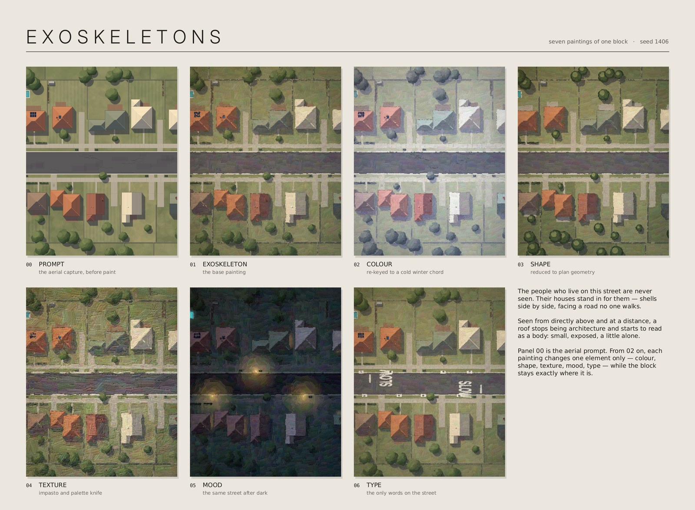

# EXOSKELETONS

Seven paintings of one suburban block, seen in strict orthographic plan from above. Written in Processing 4.

Nobody appears on the street. The houses stand in for the people inside them: shells placed side by side, facing a road no one walks. Seen from directly overhead, a roof stops reading as architecture and starts to read as a body.

## How the sketch makes a painting

1. **Prompt.** A flat aerial capture of the block is drawn into an off-screen buffer. It includes hip and gable roofs lit by a low late-afternoon sun, long cast shadows, pools, sheds, fences, bins at the kerb, a parcel at a door and an oil stain where a car usually stands.
2. **Paint.** That buffer is repainted in four passes of brush strokes, coarse to fine. Each stroke is a bundle of bristles:
   - Each bristle is a slightly different colour, with ragged ends and a small bow.
   - Strokes run along edges and stop where the reference colour changes.
   - The side of the stroke facing the sun is lifted a little.
3. **Surface.** Every bristle is also written into a height buffer. The height buffer is embossed against the same sun, and canvas weave, grain, a thin glaze and a vignette are added.

## The series: one element changes per panel

The seed holds the block constant, down to every tree and parcel. After the base painting, each panel changes one element only.

| # | Element | What changes |
|---|---|---|
| 00 | Prompt | The reference before paint |
| 01 | Exoskeleton | The base painting |
| 02 | Colour | Palette only: a cold, raised winter chord |
| 03 | Shape | Plan geometry only: small objects removed, trees become discs, pools become rectangles |
| 04 | Texture | Surface only: larger brushes, heavier impasto, palette-knife drags |
| 05 | Mood | Light only: night, street lamps, a few windows still lit, glowing pools |
| 06 | Type | The street's only words: kerb numbers and a SLOW road legend, painted with the same strokes as the houses |

On 06 the far row's kerb numbers read upside down. They face the road, which is how they would look from directly overhead. SLOW is stretched in the direction of travel for drivers who never arrive.

## Running it

Open `Exoskeletons.pde` in Processing 4 and press Run. Each panel takes about 5–10 s to paint.

| Key | Action |
|---|---|
| `0`–`6` | Paint that panel |
| `n` | New block (new seed) |
| `r` | Toggle between reference and painting |
| `s` | Save the current panel at 1600 × 2000 to `output/` |
| `e` | Export all seven panels and the contact sheet |

To change the zoom, edit `Z`. To change the brush scale per panel, edit `radii` in `makeLook()`. The palettes are in `basePalette()`, `frostPalette()` and `nightPalette()`.
