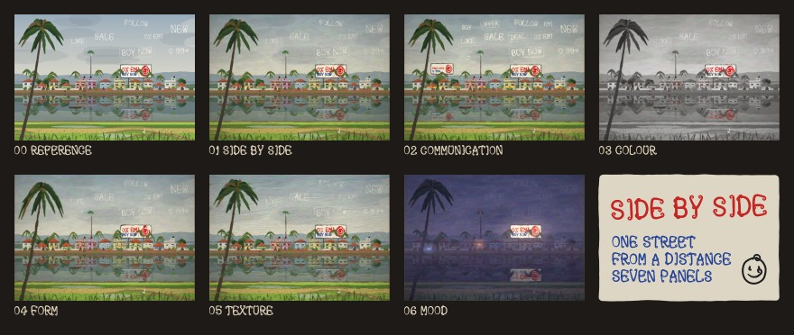

# SIDE BY SIDE

Seven paintings of one Kerala street, seen from across the water. Written in Processing 4.

A dozen middle-class houses stand side by side on the far bank of a backwater. Seen from across the water and the paddy, they are too small to read as architecture. Each one becomes a face instead: curtains drawn halfway like lids, sunshades that droop at the outer ends like brows, monsoon streaks running down like tears. The houses stand close together, and each one is alone. No one is out. The scooters on the bund are under covers, with petrol at about ₹115 a litre.

A hoarding with a smiling face stands over them, and that face is the only one smiling. Beside it is a mobile tower dressed up as a coconut palm. The sky carries faint messages: LIKE, FOLLOW, ♥ 99+, BUY NOW. The water reflects the houses and the offer, upside down and rippled. The natural elements carry the distance: hills, a tree line, the backwater, an empty country boat, paddy at different stages, a single heron, and a near palm you look past.

## How the sketch makes a painting

1. **Reference.** The world is drawn flat. No outline stays geometric: corners are rounded and edges are pushed around by noise. The water is the drawing itself, mirrored at the water's edge, rippled more with distance and tinted.
2. **Paint.** The reference is repainted in five passes of bristle strokes, from coarse to fine.
   - Each stroke follows the structure of the image and stops where the colour changes.
   - Each stroke picks up a little of the wet paint already on the canvas.
   - The individual bristles vary in colour and in how much paint they carry.
   - The paint goes onto a warm sienna ground, which shows through where the brush runs dry.
3. **Last layer.** The lettering, faces and wires are painted with a pointed sign-writer's brush. Contours are scratched back to the ground (sgraffito). The height of every bristle is lit from the upper left, then canvas tooth, varnish and a vignette are added.

The lettering uses a hand-built curly alphabet (A–Z, 0–9, ₹, %, ♥, +, !). Each character is a spline skeleton whose open ends finish in a spiral. No fonts are used anywhere, including the contact sheet.

## The series: one element changes per panel

The seed holds the street constant. After the base painting, each panel changes one element only.

| # | Element | What changes |
|---|---|---|
| 00 | Reference | The flat drawing, before paint |
| 01 | Side by Side | The base painting |
| 02 | Communication | Communications design only: a second hoarding, every sky message painted solid, and sale banners hung across the houses (over the mouth of a two-storey house, over the eyes of a single-storey one) |
| 03 | Colour | Every colour goes to a grey of the same value, except true reds. The advertiser's red keeps its colour, along with the hibiscus and one scooter cover. The terracotta roofs fall just outside the window and turn grey. |
| 04 | Form | Outlines only: corners soften four times as much, walls bulge, houses lean, brows and lids droop, fronds hang |
| 05 | Texture | Surface only: larger brushes, heavier impasto, palette-knife drags through sky, water and paddy, and a second wandering pass of sgraffito |
| 06 | Mood | Light only: a power cut at dusk, with mist on the water. The hoarding is still floodlit and is the brightest thing in the picture, along with its reflection. One phone and one lamp glow behind curtains, and the tower's red light is on. |

## Running it

Open `SideBySide.pde` in Processing 4 and press Run. Each panel takes about 5–9 s to paint.

| Key | Action |
|---|---|
| `0`–`6` | Paint that panel |
| `n` | New street (new seed) |
| `r` | Toggle between reference and painting |
| `s` | Save the current panel at 2000 × 1400 to `output/` |
| `e` | Export all seven panels, previews and the contact sheet |

The sketch holds several full-size buffers at once. If Processing runs out of memory, raise the maximum memory in Preferences.

- The hoarding copy is `l1` / `l2` in the `World` constructor.
- The house banners are `bn` and the sky messages are `gw`, in the same constructor.
- `S` sets how far away the street is, in pixels per metre.

The painter and the alphabet are shared with the [Surrogates](../Surrogates) series. The composition, world and series here are new.

The petrol figure is about what Thiruvananthapuram paid in late 2026. Several price trackers listed about ₹115 a litre in September 2026.
