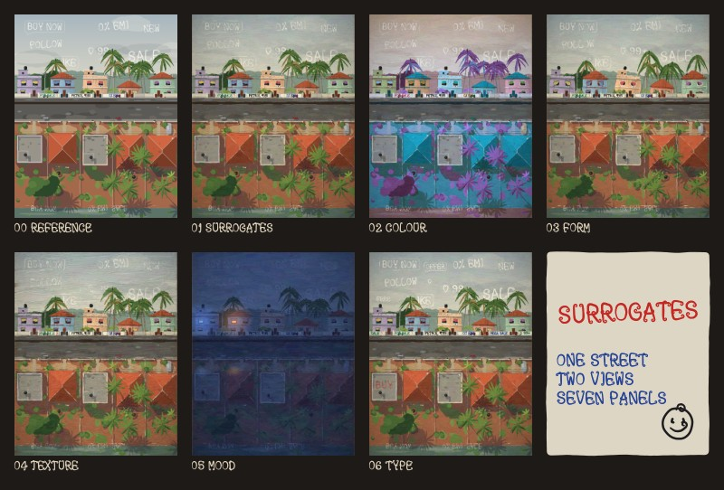

# SURROGATES

Seven paintings of one Kerala street, each a pair of views of exactly the same places. Written in Processing 4.

The street is full of middle-class houses, but no one is outside. The two scooters are under covers and the car is under a sheet, parked since petrol passed ₹115 a litre. The walls carry offers meant for everyone: 0% EMI, MEGA SALE, FREE DATA. The sky above carries a fainter set: LIKE, FOLLOW, ♥ 99+. The facades stand in for the people who live behind them. Their windows have curtains drawn halfway down like lids. Their sunshades droop at the outer ends like brows, and the monsoon has left dark streaks below them. The only faces that smile are the ones painted on the advertisements.

## One world, two views

The sketch builds a single model of the street and draws it twice:

- **Top: elevation.** You stand across the road at eye level and look straight in.
- **Bottom: plan.** The same street seen from directly overhead, with the road along the top edge.

Both views use the same horizontal scale (`PX`, 28 px per metre). Every house, gate, palm, pole, crow, scooter and parcel therefore sits at the same x in both halves. A crow on the wire above is a small dark mark at that same x below. The light behind one curtain in 05 spills onto that house's yard in the plan. From above, the houses shrink into the land around them. A hip roof reads as a head, the water tank as an eye and the satellite dish as an ear.

## How the sketch makes a painting

1. **Reference.** The world is drawn flat. No outline stays geometric: every corner is rounded, every edge is resampled and then pushed around by noise.
2. **Paint.** The reference is repainted in five passes of bristle strokes, from coarse to fine.
   - Each stroke follows the structure of the image and stops where the colour changes.
   - Each stroke picks up a little of the wet paint already on the canvas.
   - The individual bristles vary in colour and in how much paint they carry.
   - The paint goes onto a warm sienna ground, which shows through where the brush runs dry.
3. **Last layer.** The lettering, faces, gate scrolls and wires are painted with a pointed sign-writer's brush. Contours are scratched back to the ground (sgraffito). The height of every bristle is lit from the upper left, then canvas tooth, varnish and a vignette are added.

### The curly alphabet

No fonts are used anywhere, including the contact sheet. Each character (A–Z, 0–9, ₹, %, ♥, +, !) is a skeleton of points on a 4 × 6 grid. Splines run through the points. Every open terminal ends in a spiral that winds back toward the body of the letter. Stroke width swells in the middle of each stroke and thins into the curls. Each letter gets its own small bounce, tilt and scale. The skeletons are in `initGlyphs()`.

## The series: one element changes per panel

The seed holds the street constant, down to every palm frond. After the base painting, each panel changes one element only.

| # | Element | What changes |
|---|---|---|
| 00 | Reference | The flat drawing, before paint |
| 01 | Surrogates | The base painting |
| 02 | Colour | Every hue turned to its complement in YIQ space, with luma kept exactly. Earth and roofs go teal, vegetation violet, the sky mauve. Values and drawing are untouched. |
| 03 | Form | Outlines only: corners soften four times as much, walls bulge, houses lean, brows and lids droop, roofs slump, palms bend further. Plan roofs become pillows. |
| 04 | Texture | Surface only: larger brushes, heavier impasto, palette-knife drags through sky, road and canal, and a second wandering pass of sgraffito over everything |
| 05 | Mood | Light only: a power cut at night. One window glows with a phone screen and one with an emergency lamp, and each spills onto its own yard in the plan. |
| 06 | Type | Lettering only: an offer on every stretch of wall, the sky messages painted solid, the canal reflection lettered and BUY painted on a terrace for satellites |

In the plan, the canal at the bottom reflects some of the sky messages, mirrored.

## Running it

Open `Surrogates.pde` in Processing 4 and press Run. Each panel takes about 5–12 s to paint.

| Key | Action |
|---|---|
| `0`–`6` | Paint that panel |
| `n` | New street (new seed) |
| `r` | Toggle between reference and painting |
| `s` | Save the current panel at 1600 × 2000 to `output/` |
| `e` | Export all seven panels, previews and the contact sheet |

The sketch holds several full-size buffers at once. If Processing runs out of memory, raise the maximum memory in Preferences.

- To change the brush scale per panel, edit `radii` in `Look`.
- To change the wall copy, edit `copy` in the `World` constructor.
- To change the sky messages, edit `gw` in the same constructor.
- The house palettes are the arrays at the top of the file.

The petrol figure is about what Thiruvananthapuram paid in late 2026. Several price trackers listed about ₹115 a litre in September 2026.
